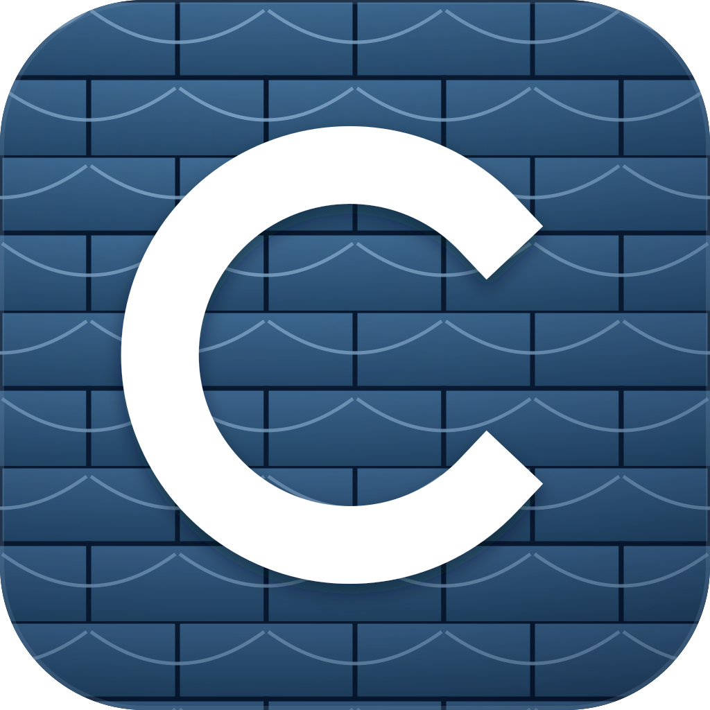

# ChatStudio



A local-first desktop building energy modeling assistant. Electron + React supplies
the interface; Pi supplies the agent loop; native OpenStudio MCP supplies tools and
workflow guidance. Modeling and simulation use native desktop runtimes.

**Status: unsigned preview.** The self-contained macOS ARM64 installer includes
native SDK/CLI, EnergyPlus, Python, Ruby/gems, and Measure assets. Cross-platform
CI builds desktop-only previews; native bundling has not been deployed to CI.

Download desktop-only previews from
[GitHub Releases](https://github.com/luzechao/ChatStudio/releases).
These installers require an external native runtime; Windows native modeling
is not yet enabled. The local self-contained Apple Silicon build is not
published while third-party redistribution review is pending, including the
gbXML source repository's missing repository-level license.
See each release's notes for limitations.

## What works

- Desktop chat UI, streaming Pi events, provider/model selection, and user API keys.
- Distinct, labeled user/assistant message bubbles and assistant Markdown rendering
  (headings, lists, tables, task lists, blockquotes, inline/fenced code). User
  messages stay plain text. Generated HTML is disabled; images do not load, and
  links display their URL as text without opening or navigating automatically.
- Light, Dark, and Follow system appearance options in Settings. Follow system
  is the default and updates live; your choice is saved across restarts.
- A separate Electron utility process for the Pi agent and MCP client.
- Native MCP execution wrapped in Anthropic Sandbox Runtime, with no unsandboxed fallback.
- Tool discovery/search rather than placing all 206 tool schemas in every model request.
- Explicit approval for backend tools, including reads, with optional per-tool
  session permission and revocation.
- Native OpenStudio 3.11.0 Python model creation, inspection, and OSM saving.
- Local macOS bundle: native CLI, embedded Ruby/gems, Python/MCP, EnergyPlus,
  common/ComStock/gbXML Measure assets, and an offline design-day simulation.
- Discovery of all 206 upstream tools and all 18 workflow skills.
- Project workspace/file listing and private, project-specific conversation history.
- Read-only 3D OSM viewer, EnergyPlus SQL results dashboard, and isolated HTML reports.
- Project/runtime settings and conversations on disk; optional OS-encrypted API key storage.

Discovery does **not** establish that every tool works. The local bundle verifies
representative Measure/simulation workflows, not every ComStock, reporting, or
gbXML operation. Skills are retrieved through MCP tools; their presence does not
imply their complete workflows are runnable.

## Self-contained macOS Apple Silicon preview

The local native build is under `release-native/mac-arm64/ChatStudio.app`, with
DMG and ZIP installers alongside it. Users of this build do not need to install
Python, OpenStudio, Ruby, gems, EnergyPlus, or the included Measure collections.
It is unsigned and not notarized; public distribution still needs signing and a
third-party license review.

Included runtimes and assets:

| Component | Version / source |
|---|---|
| OpenStudio SDK/CLI | Official 3.11.0 ARM64 distribution + Python SDK wheel |
| EnergyPlus | 25.2.0, supplied by the official OpenStudio distribution |
| Python for MCP/tests | Relocatable CPython 3.13.18, python-build-standalone 20261026 |
| Ruby | OpenStudio CLI's embedded Ruby 3.2.2, not a separate system installation |
| Ruby gems | Extracted from the official CLI, including standards 0.8.5, extension 0.9.7, workflow 2.5.0 |
| MCP / skills | Pinned upstream revision; all 206 tools and 18 skills discovered |
| Common Measures | v0.12.3, pinned commit |
| ComStock Measures | 2025-3, pinned commit |
| gbXML Measures / seed | v1.2.4, pinned commit |

Build and verify locally:

```sh
npm run setup:bundle        # Downloads/builds only inside .runtime/
npm run test:bundle         # Real SDK, Ruby/Python Measures, native simulation
npm run package:native     # Local macOS ARM64 .app + DMG + ZIP
npm run test:relocated     # Copies app to a path with spaces; native resources read-only
```

The setup uses checksummed runtime archives, fixed source commits, exact Python
dependency versions, a Ruby dependency lock, and preserved upstream notices.
It needs network access while assembling the bundle, but no downloads at runtime.
Downloads and sources are cached locally. This is separate from `setup:native`,
which remains the smaller external-runtime development setup.

First launch uses the included runtime automatically and creates a project under
`Documents/ChatStudio Projects/first-building`. Choose your own project folder
if desired, then **Connect local engine**. Existing external-runtime
configurations are preserved: disconnect first and choose **Use included native
runtime** in Settings. Saved bundled paths are rebuilt after the app moves.
**Configure external runtime** unlocks manual runtime fields.

The bundled `ruby` command adapts the flags used by MCP (`-c`, `-I`, script
execution, `-e`, version) to OpenStudio's embedded Ruby. Unsupported flags fail
explicitly; this is not a general-purpose replacement for a system Ruby/gem
development environment. The CLI has its own embedded Python environment;
the separately bundled CPython runs MCP and Python Measure tests.

The relocation gate removes Homebrew from PATH, makes native resources read-only,
checks installed-app discovery and connection, tests Measures, and runs an offline
EnergyPlus design-day workflow with SQL output and zero severe errors. Annual
weather-driven simulations, every Measure/tool, and clean-machine compatibility
across macOS versions still need wider validation.

## Run on this Mac

The Node dependencies and isolated Python SDK/MCP environment have already been
installed during initial development.

```sh
cd /Users/zlu/Documents/GitHub/ChatStudio
npm run dev
```

In Settings:

1. Select an API-key provider/model and enter your key. No API key is bundled.
2. The native setup configuration is detected automatically when no saved settings exist.
3. Click **Connect local engine**.
4. Open chat and try: “Create an example OSM, summarize it, and save it.”
5. Review requested backend calls. Choose **Allow once**, **Deny**, or
   **Allow this tool for this session**.

Generated models live under the selected project's `runs/` directory. The initial
project is `projects/first-building/`. Copy inputs into its `inputs/` folder;
absolute paths are visible in Settings and should be used in tool requests.

Provider requests send chat and selected tool results to the chosen provider.
Local modeling does not imply private/offline inference.

### Project workspace and history

Use **Open project folder** or **Recent projects** in the sidebar. **Project
workspace** lists project file paths and sizes (not file contents), including
inputs and simulation outputs. Refresh the listing after external changes.
Hidden files, dependency directories, and symlinks are skipped; large/deep
listings are capped and marked as incomplete.

Conversations are saved automatically in ChatStudio's private application data
directory, separated by the project's canonical folder path. Reopen the same
folder to see its **Conversation history**, including after restarting the app.
These are read-only user/assistant transcripts, not complete tool logs: browsing
them never replays tools or resumes the AI session. **Back to current chat**
returns to the live conversation. **New conversation** starts a fresh AI context
and clears session tool permissions without deleting earlier saved chats.

Switching projects clears the live chat and disconnects the local engine; connect
again to use modeling tools in the new folder. Switching is disabled during a
response. Renaming/moving a project folder gives it a new history identity.
Messages, model paths, and provider error text can contain sensitive information;
history is local plaintext, not encrypted. The active API key is redacted from
saved messages, but do not paste other credentials into chat. Conversations sent
before this feature was installed cannot be recovered.

### Model and results viewers

Use the **Chat**, **Model**, and **Results** tabs in the top bar. Appearance
(Light / Dark / Follow system) is under **Settings**.
Open a project, then choose:

- **3D model**: choose a saved `.osm` and **Load viewer**. Orbit with left-drag,
  pan with right-drag, scroll to zoom, or use **Fit model**. Click a surface to
  inspect its space, thermal zone, construction and boundary condition. Filter
  by space, color by surface type or zone, and hide roofs to inspect interiors.
  Space surfaces and openings use OpenStudio's site/world transformations,
  including space origins/rotation. This first version displays saved geometry,
  not shading objects, HVAC schematics, or expanded zone multipliers.
- **Simulation results (SQL)**: select a completed run's `eplusout.sql`. View
  site energy, energy per total floor area, building area, end-use bars by fuel,
  and searchable report tables (including zone/component sizing when reported).
  Units come directly from the SQL, without guessed conversion. Missing values
  show **Not reported**, not zero. A warning identifies results with no
  weather-run environment; design-day outputs are not annual performance.
- **HTML report**: preview a generated report, including EnergyPlus tabular
  HTML. Scripts, navigation, forms and remote resources are disabled. Charts
  requiring JavaScript and external images are intentionally not rendered.

Use **Refresh** if external files changed. If a file is beyond the listing
limit, expand **File not listed?** and enter its project-relative path.
**Load viewer** also reloads the selected file. Views are snapshots; unsaved
agent changes are not displayed. No API key or MCP connection is needed, but
native OSM/SQL inspection requires the included runtime or a configured
`OPENSTUDIO_CLI`. After changing external runtime settings, save them by
connecting the engine before loading a viewer.

Inspection runs a fixed native reader in a separate OS-confined process; it
does not execute model Measures or replace the agent's loaded model. SQL is
queried from a temporary project-local copy, leaving the original untouched.
Viewer inputs must resolve inside the current project. Limits are 512 MB per
OSM/SQL input, 24 MB extracted data, 50,000 surfaces/openings, 20,000 SQL cells,
and 10 MB per HTML report. Extraction times out after 90 seconds. Time-series
plots, model editing and live result overlays are not part of this first version.

### Session tool permissions

The **Internet access** switch in Settings controls outbound internet access
for the local modeling backend. It is off by default and saved across restarts.
Changing it disconnects the engine and clears session tool permissions; reconnect
to apply the saved policy. Enabled tools may download resources or transmit
project data, subject to normal tool approval. Filesystem protections remain
unchanged. AI-provider requests are separate and are not disabled by this switch.
Native model/results viewers remain offline regardless of the switch.

**Allow this tool for this session** approves the current call and future calls
to that exact tool with any arguments. Other tools still prompt. Active grants
appear under **Allowed this session** in the sidebar, with a **Revoke** button
for each. Revoking affects future calls, not work already running.

Grants stay in memory only and clear on New conversation, backend reconnect or
disconnect, provider/model/endpoint changes, and app restart. Stop cancels pending
approvals but preserves existing grants. The OS sandbox and tool/turn limits
remain enforced for automatically approved calls.

### OpenAI-compatible endpoints / LiteLLM

In Settings, select **OpenAI-compatible / LiteLLM**, enter the **API base URL**
(for example `https://company-gateway.example/v1`) and the exact **Model /
deployment name** configured by your company. Use the API root, not the
`/chat/completions` endpoint. Enter the gateway's key in the API key field, then
choose **Open chat** (or connect the modeling backend).

The base URL and model are saved across restarts. Keys stay in memory unless you
enable **Remember API key on this device** (see below). Requests use streaming Chat Completions with
tool calling, so the deployment must support these features for modeling.
Custom models default to a 32,768-token context and 4,096-token output budget.
Use HTTPS for company services; HTTP is available for trusted local development.

### Optional encrypted API key storage

In Settings, enter a key and enable **Remember API key on this device** to save
it immediately with Electron's OS-backed `safeStorage` encryption: macOS
Keychain, Windows DPAPI, or a supported Linux Secret Service/KWallet store.
Only encrypted bytes are written to ChatStudio's private application data
directory, never project folders, configuration JSON, or browser storage.
There is no plaintext fallback: saving is disabled when secure encryption is
unavailable, including Linux's insecure `basic_text` backend.

Keys are separated by provider. Custom OpenAI-compatible keys are additionally
separated by normalized API base URL, not model, so switching company endpoints
cannot reuse another endpoint's saved key. Selecting that provider/endpoint
restores its key automatically; changing the endpoint clears the current key.
When editing a remembered key, use **Update saved key**, **Open chat**, or
**Connect local engine** to save the replacement.

Uncheck the option or click **Forget saved key** to remove the encrypted copy.
The current in-memory key remains usable until you switch provider/endpoint or
quit; clear the API key field to stop using it immediately. With remembering
disabled, keys must be entered again after restart.

OS encryption protects keys at rest, not against malicious software running as
your logged-in user. Keys are decrypted in memory for provider requests and are
never forwarded to the native modeling backend. Moving encrypted files to a
different OS account/machine may make them unreadable. Unlock the OS credential
store or forget/re-enter a key if decryption fails.
The configured endpoint receives your key, chat, and tool results. System-trusted
company CA certificates are supported without disabling TLS verification.
Start a new conversation before changing provider, model, or endpoint.

## Set up another development machine

Requirements: Node.js >= 22.19, npm, Git, and a Python version with an OpenStudio
3.11.0 wheel for the target OS/architecture. Python 3.13 was verified on this Mac.
The host must also support the required native process sandbox.

```sh
npm ci
# If npm blocked Electron's download lifecycle script:
node node_modules/electron/install.js

# macOS example; otherwise choose an appropriate installed Python.
CHATSTUDIO_PYTHON=python3.13 npm run setup:native
npm run dev
```

The native setup script creates `.runtime/venv`, checks out MCP commit
`e0a47a9c50aa6c52f77ba63540118bb816d12726`, installs it from
`requirements-native.txt`, and writes `.runtime/backend.json`.
It does not modify global Python packages or install a system-wide OpenStudio.
Review the read-only runtime paths it grants. Homebrew Python requires access to
its interpreter framework and linked library packages; the setup script derives
those paths using `otool` on macOS.

Node dependencies are locked in `package-lock.json`. The native MCP revision and
SDK version are pinned, but all transitive Python dependencies are not yet locked.
Overrides pin patched Undici and Zod releases; Zod's compatibility exports retain
the dependency APIs used by MCP/Sandbox Runtime. The integration gates cover them.

## Architecture

```text
Sandboxed Electron renderer (React, no Node or direct network access)
    |
    | Narrow, sender-checked preload IPC
    v
Electron main process (settings and desktop lifecycle)
    |
    v
Agent utility process (Pi, in-memory provider credentials)
    |
    | MCP stdio
    v
OS-sandboxed native MCP process and its descendants
    |
    +-- Native OpenStudio Python SDK
    +-- OpenStudio CLI / Ruby / Measures [additional installation]
    +-- EnergyPlus [additional installation]
```

Pi's built-in shell/file tools, arbitrary extensions, project instructions, and
automatic skill-file execution are disabled. The two exposed agent tools search
the backend catalog and invoke approved MCP tools. MCP skill documents are treated
as untrusted workflow guidance, not executable Pi extensions.

Changing the provider/model requires a new conversation. Reconnecting the backend
resets Pi's conversation to avoid stale model context. New conversation resets chat,
not the MCP server's current building model. All sessions are ephemeral in this preview.

## Sandbox boundaries and limitations

- The entire MCP server and its descendants are wrapped, not just the EnergyPlus executable.
- User-home reads are denied except explicitly allowed project/dependency roots.
- ChatStudio private state is denied. Dependencies are read-only.
- Workspace writes are allowed; the runtime additionally permits its standard
  temporary/device paths. This is not a hermetic filesystem image.
- Direct backend sockets remain restricted. The default policy denies outbound
  access; enabling **Internet access** permits outbound connections through the
  sandbox proxy (for example downloads and remote analysis). Private-network
  and local-listening restrictions remain in place.
- Provider keys are not forwarded to the MCP process. Native environment overrides
  are restricted to recognized runtime configuration variables.
- Approvals expire after two minutes. There is a per-message backend-call limit
  and agent-turn limit.
- **Stop** aborts the agent/request. It is not a guarantee that a simulation job
  already accepted by MCP has stopped; use the backend's `cancel_run` workflow.
- The agent process itself is trusted and not OS-sandboxed; it needs provider
  access. Only the MCP process tree is confined.
- The current macOS mechanism uses deprecated `sandbox-exec`, as used by the
  selected Sandbox Runtime release. It is defense in depth, not a VM boundary.
- **macOS ARM64:** actual filesystem, network, child-process, and secret-environment
  denial tests passed, including a real native SDK/MCP workflow.
- **Linux:** implementation targets Sandbox Runtime's bubblewrap backend, but has
  not been validated here. Install its required dependencies and run the gates.
- **Windows:** UI architecture is portable, but native backend launch intentionally
  refuses execution until the Windows confinement/launch adapter is validated.
  There is no automatic insecure mode.

Do not grant all of your home directory or place provider secrets in projects or
runtime folders. This preview is not certified for executing hostile third-party
code and has no hard CPU/memory quota implementation.

## Configuring an external native simulation distribution

The Python SDK is **3.11.0**, matching the upstream MCP package.

For desktop-only CI previews, install a matching native OpenStudio distribution
with its CLI, Ruby bindings/runtime, and matching EnergyPlus. In runtime settings:

- Set `OPENSTUDIO_CLI` to the absolute CLI executable. ChatStudio adds its directory
  to the child's PATH; upstream commands invoke `openstudio`.
- Add the installation's dependency roots to read-only paths.
- Set `OSCLI_GEMFILE` and `OSCLI_GEM_PATH` for the required gem environment.
- Install and configure `COMMON_MEASURES_DIR`, `COMSTOCK_MEASURES_DIR`,
  `GBXML_MEASURES_DIR`, and `GBXML_SEED_OSM` as needed.

The upstream Docker recipe documents the expected asset versions, but ChatStudio
does not require or run Docker. Cross-platform native packaging, complete notice
review, signing, and full tool coverage remain work.

## Validation

The AI agent uses both bundled and operating-system trusted CA certificates.
This supports HTTPS inspection with a locally trusted certificate, including
OpenRouter connections. TLS certificate verification remains enabled; untrusted
or invalid certificates are not accepted.

```sh
npm run typecheck
npm test                    # Config, approvals, actual OS confinement probes
npm run test:native         # Requires setup:native; real SDK/MCP and Pi loop
npm run build
npm run test:desktop        # Requires build + setup:native; launches real Electron
npm run test:provider       # Requires build; local OpenAI-compatible HTTP diagnostic
npm run test:bundle         # Requires setup:bundle; native Measure/simulation gate
npm run test:relocated      # Requires package:native; installed native bundle gate
npm audit
```

For the real-building viewer gate, set `CHATSTUDIO_VIEWER_OSM` to the Chicago
large-office OSM and `CHATSTUDIO_VIEWER_SQL` to its completed annual EnergyPlus
SQL output (with the companion `eplustbl.htm`), then run `npm run test:viewers`. It checks source-file hashes,
native geometry/results, actual 3D surface picking and controls, report values,
and inert HTML preview. Set `CHATSTUDIO_EXECUTABLE` to validate the packaged UI.

The native gate uses Pi's scripted local test provider, not a paid/cloud model.
It verifies discovery of 206 tools/18 skills, approved native model creation,
exact model counts (four spaces, one thermal zone), OSM persistence, denied edits,
disabled general agent tools, and credential cleanup. Live provider inference
requires the user's key and was not exercised during development.

The desktop gate verifies the renderer/preload boundary, catalog loading, real
sandboxed MCP connection, disconnect behavior, and captures a local preview.
All development helpers exit after verification.

The provider diagnostic starts an ephemeral, loopback-only OpenAI-compatible mock
host and sends requests through the real ChatAgent/Pi stack in an Electron utility
process. It checks streamed text, request paths/authentication, HTTP 401/429
errors, dropped connections, and credential cleanup. It requires no real API key,
native MCP runtime, or paid inference. The host is a protocol fixture, not a local
language model, and shuts down after the test. A passing result isolates basic
request/streaming behavior; it does not verify a specific remote provider or key.

## Next milestones

1. Extend the locally verified macOS native bundle to CI and other platforms.
2. Add verified simulation/cancellation/reporting workflows and capability indicators.
3. Extend model/results viewing with time-series plots and model revision checkpoints.
4. Add resumable conversations.
5. Validate Linux/Windows confinement and ship signed platform-specific installers.

## Desktop builds and GitHub releases

The GitHub Actions workflow builds macOS Apple Silicon (DMG and ZIP),
Windows x64 (NSIS installer), and Linux x64 (AppImage and DEB). Pushes to `main`,
pull requests, and manual runs execute type checks, unit tests, local provider
diagnostics, packaging, and a packaged-app smoke test. Linux confinement tests
run on the disposable runner with bubblewrap prerequisites installed; Windows
confinement is not implemented and is never bypassed.

Build artifacts are retained for 14 days. To create a release, update the package
version and lockfile, commit, and push a matching `v<version>` tag. After every
platform passes, the workflow creates a **draft prerelease** with installers and
SHA-256 checksums. Review and test it before publishing. The workflow token only
has repository-write access in the release job.

The current CI artifacts are **unsigned desktop previews**, not native bundles.
The installed app contains neither development projects nor `.runtime`, keys,
or a relocatable Python/OpenStudio distribution. macOS/Linux users must configure
an external native runtime. Windows supports AI chat/settings but refuses native
modeling until its sandbox launch adapter is validated. Signing/notarization,
runtime bundling, Ruby gem/Measure assets, licensing review, and full native
workflow verification remain release blockers for production distributions.
The separate local `package:native` build described above does include runtimes;
it has deliberately not been wired into CI yet.

Local packaging:

```sh
npm run package -- --mac --arm64  # On Apple Silicon macOS
npm run package -- --win --x64    # On Windows
npm run package -- --linux --x64  # On Linux
CHATSTUDIO_EXECUTABLE="release/mac-arm64/ChatStudio.app/Contents/MacOS/ChatStudio" npm run test:package
```

Resources are deliberately unpacked (`asar: false`) so utility processes and
native sandbox helper executables can use real filesystem paths. The packaging
allowlist includes built application code and production dependencies only.
